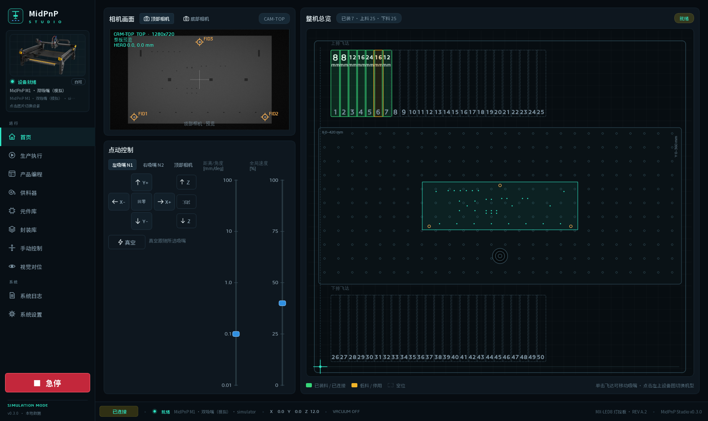
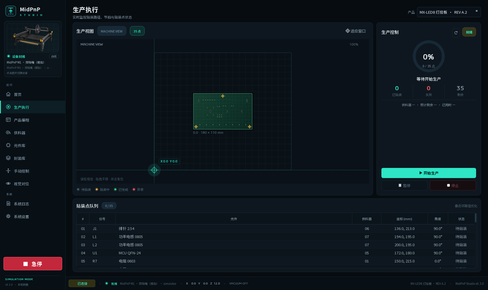
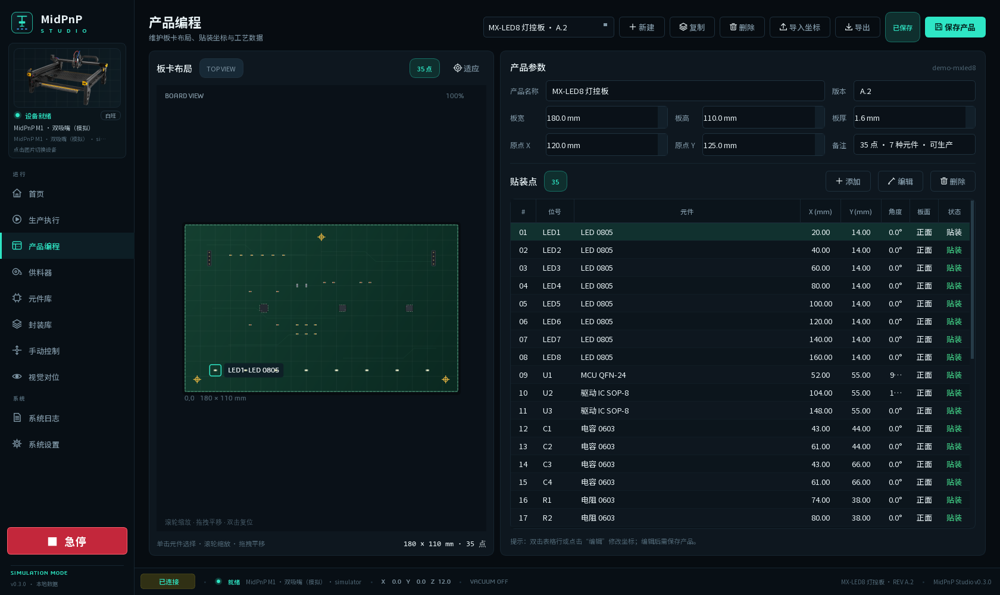
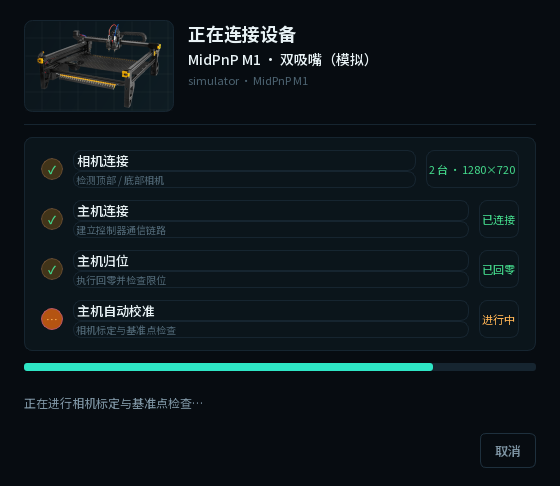
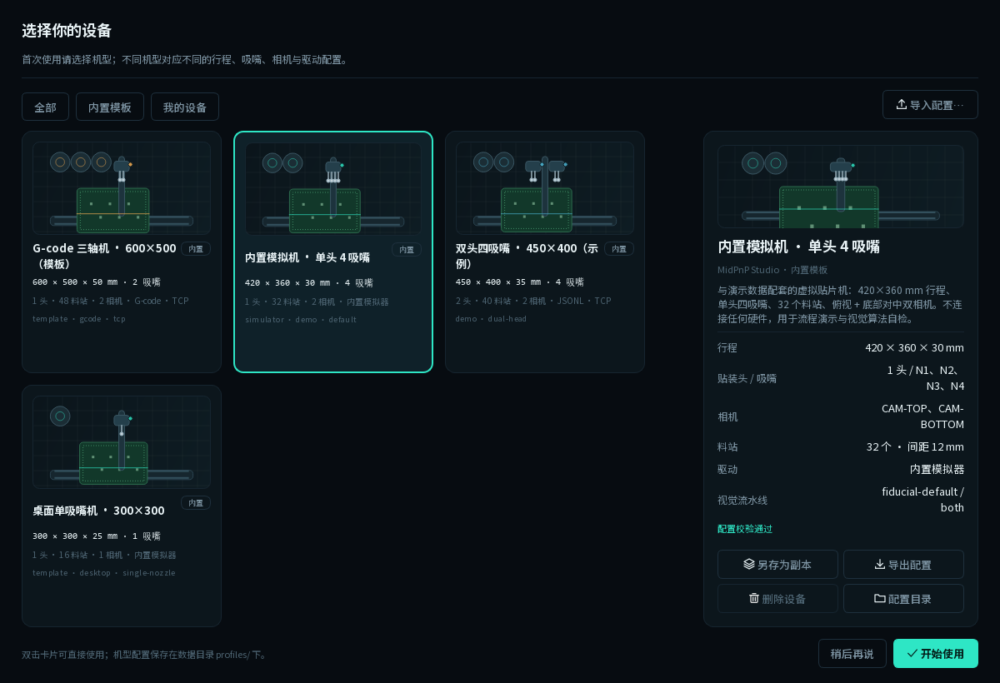

# MidPnP Studio

**桌面级 SMT 贴片机上位机软件** · Python + PySide6 + SQLite · Windows 10/11

MidPnP Studio 是一个从零搭建、可以直接运行的贴片机上位机原型。它把「产品编程 → 供料器准备 → 生产执行 → 数据记录」串成完整闭环，并内置一台可离线运行的虚拟贴片机，因此没有硬件也能演示完整生产流程。



## 已实现功能

| 模块 | 能力 |
| --- | --- |
| 设备连接 | 内置模拟器、TCP JSONL、串口 JSONL、G-code 命令表；自动重连、状态机、软限位 |
| 机型配置 | JSON 配置驱动多机型；首次启动看图选设备，之后在设置里随时更换 |
| 首页 | 16:9 单相机画面（顶/底切换）、竖置步距/速度点动、吸嘴/相机选择与跟随真空、Z 单独归位、3:7 整机线稿（飞达只显示料带规格与槽位号、点击移动） |
| 连接向导 | 相机 → 主机 → 归位 → 自动校准 四步状态弹窗，完成后状态栏显示已连接 |
| 生产执行 | 产品选择、路径规划、开始 / 暂停 / 继续 / 停止、急停、实时贴装点状态、节拍与 ETA |
| 产品编程 | 板框、原点、基准点、贴装点增删改、板卡可视化、坐标导入 / 导出 |
| 坐标导入 | 通用 CSV/TSV 列映射、KiCad `.pos`、OpenPnP 板文件；单位/镜像/偏移向导 |
| 供料器 | 料站槽位、余料、低料阈值、补料、启用/停用、取料坐标、余料进度 |
| 元件库 | 封装、尺寸、吸嘴、视觉策略、速度、颜色预览、引用检查 |
| 封装库 | 50+ 内置封装、同义名归一、模糊匹配打分、批量匹配元件库 |
| 手动控制 | X/Y/Z 点动、步长/速度、真空、吸嘴、传送带、照明、快捷定位、供料器点动 |
| 视觉对位 | 真实流水线：基准点识别、板卡仿射补偿、底部对中（仿真相机，算法与真机一致） |
| 系统日志 | 分级筛选、搜索、自动刷新、详情、CSV 导出、清空 |
| 系统设置 | 机型切换、机器行程、连接参数、仿真倍率、生产策略、备份、恢复演示数据 |

生产执行页：



产品编程页：



连接向导（相机 → 主机 → 归位 → 自动校准）：



## 快速开始

### 环境

- Windows 10/11
- Python 3.10+（本机验证：Python 3.13）
- 依赖：`PySide6`、`pyserial`、`numpy`（视觉算法）

```powershell
cd "D:\MidPnP-Studio"
python -m pip install -r requirements.txt
.\run.ps1
```

`run.ps1` / `run.bat` / `Start MidPnP Studio.bat` 都会优先使用项目内的
`.venv\Scripts\python.exe`（存在时），否则回退到 PATH 里的 `python`。
想用独立环境：

```powershell
python -m venv .venv
.\.venv\Scripts\python -m pip install -r requirements.txt
.\run.ps1
```

如果 PowerShell 执行策略禁止脚本，使用以下任一方式：

```powershell
.\run.bat
# 或
powershell -ExecutionPolicy Bypass -File .\run.ps1
```

也可以双击 **`Start MidPnP Studio.bat`**：存在 `dist` 时直接启动打包版，否则回退到源码运行。也可以直接：

```powershell
python -m midpnp
```

### 5 分钟演示

1. 首次启动会先弹出**设备画廊**（见上图下方），选好机型后点「开始使用」；接着弹出
   **连接向导**：相机连接 → 主机连接 → 主机归位 → 自动校准，完成后状态栏显示「已连接」。
   演示数据会写入「MX-LED8 灯控板」（35 个贴装点、7 种元件、7 台供料器）。
2. 打开 **生产执行**，确认产品为 `MX-LED8 灯控板`，点击 **开始生产**。
3. 观察贴装头沿优化路径移动、供料器余料减少、进度环与贴装队列表格实时更新。
4. 完成后记录自动写入「最近生产」和 SQLite；供料器余料同步扣减。
5. 可在 **产品编程** 中修改坐标、导入 CSV；在 **供料器** 中补料；在 **系统设置** 中调整仿真速度（默认 8×）。

> 演示数据只用于体验流程，不代表真实产能。真实机器接入前请完成安全评估与联调。

## 机型与视觉（v0.2）

v0.2 参考 OpenPnP 的机器模型与视觉链路，补上了三块能力：

- **配置文件驱动的多机型**：轴 / 头 / 吸嘴 / 相机 / 供料器 / 驱动 / 视觉参数都在
  JSON 里，切换机型不用改代码。首次启动先弹出图形化设备画廊（点卡片预览、双击即用），
  之后可在「系统设置 → 机型配置 → 更换 / 添加设备」再次打开。内置 4 套模板，
  见 [docs/MACHINE_PROFILE.md](docs/MACHINE_PROFILE.md)。


- **坐标导入 + 封装匹配**：CSV/KiCad `.pos`/OpenPnP 板文件，带列映射、单位、镜像、
  偏移向导；导入时按同义名与尺寸自动匹配封装。见 [docs/IMPORT_AND_PACKAGES.md](docs/IMPORT_AND_PACKAGES.md)。
- **机器视觉**：基准点识别 → 多基准点仿射补偿 → 底部对中，全部真实算法（numpy），
  在仿真相机上可复现。见 [docs/VISION.md](docs/VISION.md)。

与 OpenPnP 的逐项对照和差距清单见 [docs/OPENPNP_MAPPING.md](docs/OPENPNP_MAPPING.md)。

## 数据位置

默认数据目录：

```
%LOCALAPPDATA%\MidPnP Studio\
├─ midpnp.db        # SQLite：产品、元件、供料器、生产记录、日志
├─ settings.json    # 应用设置（含当前机型 ID）
├─ profiles\        # 用户机型配置（JSON，可手改）
├─ packages.json    # 用户封装库（覆盖内置同名封装）
├─ logs\            # 崩溃日志
└─ exports\         # 导出文件默认目录
```

可用环境变量或启动参数覆盖（便于做成便携版）：

```powershell
$env:MIDPNP_DATA_DIR = "D:\MidPnPData"
python -m midpnp --data-dir "D:\MidPnPData"
```

## 打包 Windows 可执行程序

```powershell
python -m pip install -r requirements-dev.txt
.\build.ps1
```

如果执行策略禁止 `.ps1`，双击 `build.bat`，或：

```powershell
powershell -ExecutionPolicy Bypass -File .\build.ps1
```

产物：

- `dist\MidPnPStudio\MidPnPStudio.exe`（目录版，启动快，便于替换文件）
- `release\MidPnPStudio-v0.1.0-win64.zip`

`build.ps1` 会依次运行单元测试、PyInstaller 打包、启动自检并生成 zip。

> 当前 exe 未做代码签名，首次运行可能出现 Windows SmartScreen 提示；正式交付前应使用企业证书签名。

## 硬件接入

当前仓库提供三层能力：

1. **模拟器**：`midpnp/core/machine/simulator.py`，完整执行回零、点动、取料、贴装、传送带、急停。
2. **TCP / 串口适配器**：`midpnp/core/machine/tcp.py`、`serial_link.py`，使用 UTF-8 JSON Lines 协议。
3. **独立 TCP 模拟器**：方便第三方控制器或硬件工程师联调。

```powershell
python tools\machine_sim_server.py --host 127.0.0.1 --port 5025 --speed 20
```

然后在 **系统设置 → 连接方式 → TCP / 以太网** 中填写 `127.0.0.1:5025`，保存并重新连接。

协议细节见 [docs/MACHINE_PROTOCOL.md](docs/MACHINE_PROTOCOL.md)。实际机器需要实现 `status / home / move / pick / feed / place / estop / clear_fault` 等命令；坐标单位为毫米，机器原点在台面左下角，Z 向上。

## 项目结构

```
MidPnP Studio/
├─ midpnp/
│  ├─ core/                 # 纯业务层，可脱离 Qt 测试
│  │  ├─ models.py          # 产品、元件、供料器、贴装点、作业计划
│  │  ├─ profiles/          # 机型配置：schema / 库 / 校验 / 投影到设置
│  │  ├─ packages/          # 封装库：封装定义、同义名归一、匹配打分
│  │  ├─ imports/           # 坐标导入：CSV 列映射、KiCad .pos、OpenPnP 板
│  │  ├─ vision/            # 视觉：流水线、相机、基准点、底部对中
│  │  ├─ planner.py         # 可制造性检查 + 最近邻路径 + 视觉补偿
│  │  ├─ importers.py       # 旧版 CSV 导入/导出（导出仍在使用）
│  │  ├─ storage.py         # SQLite 持久化
│  │  ├─ protocol.py        # JSONL 帧解析 / 请求跟踪
│  │  └─ machine/           # 模拟器、TCP、串口、G-code 驱动、生产编排
│  ├─ data/                 # 内置机型配置与封装库（JSON）
│  ├─ ui/                   # PySide6 界面
│  │  ├─ pages/             # 10 个业务页面
│  │  ├─ widgets.py         # 板卡画布、环状进度、指标卡、Toast
│  │  ├─ theme.py           # 深色工业主题
│  │  └─ main_window.py     # 导航、状态栏、侧栏急停、页面容器
│  └─ app.py                # 启动、异常处理、数据初始化
├─ tests/                   # 113 个单元测试
├─ tools/                   # 截图、图标、TCP 模拟器、端到端冒烟
├─ docs/                    # 架构、协议、机型、视觉、导入、操作手册
├─ run.ps1 / run.bat        # 源码启动
├─ Start MidPnP Studio.bat  # 一键启动（优先打包版）
├─ build.ps1 / build.bat    # Windows 打包
└─ requirements.txt
```

## 验证

```powershell
# 单元测试（113 项）
python -m unittest discover -s tests -v

# 端到端：连接模拟器 → 完整生产 35 点 → 落库 → 校验余料
python tools\smoke_production.py

# 重新生成界面截图
python tools\make_screenshots.py
```

本项目已通过：113 个单元测试、35 点完整模拟生产、TCP 适配器联调、
G-code 命令表渲染、仿真基准点对位（0.6°/0.4 mm 可复原）、PyInstaller 启动自检。

## 重要边界与安全声明

- **视觉是仿真相机 + 真实算法**：画面由程序按机型配置渲染，识别/仿射/对中是真的；
  接入真实工业相机需要实现 `CameraSource.capture()` 并完成像素当量与畸变标定。
- **急停是软件级停止**：真实贴片机必须有独立的安全回路、硬件急停、安全门/光栅联锁。不得把本软件作为唯一安全措施。
- **单头顺序贴装**：仍采用单吸嘴顺序取放，未实现多头并行、吸嘴自动更换、飞行对中。
- **底部对中未接入生产循环**：界面可执行并给出补偿量，生产执行目前只应用板卡补偿。
- **真实硬件未经联调**：TCP/串口/G-code 是通用适配层，具体控制器指令需按厂商协议实现映射；首次上机前请空载、低速、单步验证。
- 低料默认只警告；可在设置中启用「低料停止生产」。

## 后续路线

- 底部对中接入生产循环（贴装前实时补偿）与多 pass 基准点收敛
- 真实工业相机 + 镜头畸变/轴偏角标定 + 模板匹配基准点
- 多头/多吸嘴调度与吸嘴交换、吸嘴 runout 标定
- 供料器类型扩展（编带/托盘/管装）与自动换料
- Gerber / ODB++ 直接解析
- MES / IPC-CFX / OPC UA 接口
- 用户角色与电子签名、审计追踪（GMP 风格）
- 多语言（English / 繁體）与触摸屏适配
- 真实的运动控制卡适配（固高、雷赛、Galil 等）

更详细的设计说明见 [docs/ARCHITECTURE.md](docs/ARCHITECTURE.md)，操作说明见 [docs/USER_GUIDE.md](docs/USER_GUIDE.md)。

## License

MIT © 2026 MidPnP Studio
